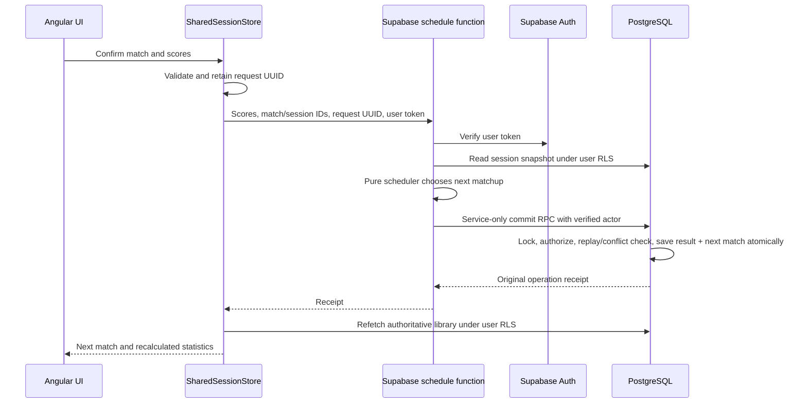

# What padel for fun currently does

[Project overview](../README.md) · [Launch review](LAUNCH_REVIEW.md) · [Domain details](DOMAIN.md)

This describes the implementation reviewed on 20 October 2026, with hosting preparation updated on 24 October. The app is an Angular/TypeScript website for five or six players on one court, with no predetermined number of matches. Hosted migrations are applied, the frontend is served with security headers, and the scheduling Edge Function is deployed with basic origin/authentication checks passing. The frontend host is Cloudflare Workers Static Assets, configured through `frontend/wrangler.jsonc`; Pages was the original proposal. Shared account/group verification and a complete signed-in hosted workflow remain pending.

## Screens and behavior

| Screen | Current behavior | Main files |
| --- | --- | --- |
| Login | One password field for the group's single Supabase Auth account. The email identifier comes from public config. Browser login is remembered. There is no registration, personal login, or Sign out control. | `app/auth/`, `pages/login/` |
| Clubhouse | Hero/court illustration; Start a session; Current ruleset toggles the rules over the court. An active session can be resumed. Lower tabs show the sortable all-time leaderboard or the latest five finished sessions. Ranking help is behind an info icon. | `pages/home/`, `components/clubhouse-leaderboard/` |
| All previous sessions | Full finished-session list, newest completion first, with links to saved results. It is reached from Clubhouse. | `pages/session-history/`, `components/session-list/` |
| Session setup | Select five/six saved player profiles. The UI blocks creation while another session is active; a PostgreSQL partial unique index independently enforces one active session per group, including competing requests. | `pages/session-setup/` |
| Active session | Current match, Scoreboard, and History tabs. Four players form two teams; remaining players rest. Either score opens a four-column picker; selecting one derives the other. Explicit confirmation saves and publishes the next match. End session requires confirmation. | `pages/session-detail/`, `components/score-entry/` |
| Finished session | Gold/silver/bronze podium headed Session finished, with shared places preserved. Only Scoreboard and History remain. No archive link appears in session headers. | `components/session-podium/`, `pages/session-detail/` |
| Players | Add unique trimmed names, see each player's counted sessions, and open a player page. Adding a profile does not create an Auth user. | `pages/players/` |
| Player detail | Session links/history, personal bests and aggregate statistics, plus a line chart switching between padel points per match and total session points. | `pages/player-detail/`, `components/player-trend/` |

The top bar has Clubhouse, Session, and Players links with an active highlight. The footer holds the branding. Components have separate TypeScript, HTML, and CSS files. Templates bind game rules rather than repeating the configured totals in UI copy.

## What happens when a score is confirmed

The browser cannot submit trusted team assignments or an actor identity. The Edge server carries the privileged credential, not the phone. Matching request IDs replay their receipt; a same-score repeat for the same match does not publish another match. A conflict is rejected. Ending locks the same session, cancels the unplayed match, and preserves completed history.

Player creation and ending call controlled member RPCs directly; they do not need the scheduling Edge Function. Creation and score confirmation do, because they publish trusted assignments.

## Layers of code

| Layer | Responsibility |
| --- | --- |
| `frontend/src/main.ts`, `scripts/generate-config.mjs`, and `scripts/public-settings.mjs` | Validate and generate allowlisted public config, then fetch/validate it before Angular starts. Production builds require explicit shared mode and a remote HTTPS API. Development commands retain local defaults. |
| `frontend/src/app/auth/` | Create the typed Supabase client, restore/verify login, sign in, manage token persistence/renewal, protect routes, and clear private state when identity changes. |
| `frontend/src/app/data/session-store.ts` | Typed injection token selecting the local or shared store without making pages know database details. |
| `local-session-store.ts` | Browser-local prototype records, Web Locks, local validation and cross-tab stale-write protection. |
| `shared-session-store.ts` | Shared in-memory state, loading/error/busy flags, stable retry IDs, identity-safe reads, and refetch after successful mutations. No background polling. |
| `shared-repository.ts` | User-scoped Supabase reads, snapshot mapping/runtime validation, controlled player/end RPCs, and scheduling function calls. |
| `frontend/src/domain/` | Framework-independent models, rules, score validation, scheduling, statistics, player profiles/history, and shared/local record validation. |
| `supabase/edge/` | HTTP validation, Auth verification, RLS reads, scheduler execution, privileged transaction invocation, bounded stale-revision retries, safe error mapping and CORS. |
| `supabase/migrations/` | PostgreSQL schema, scope/score/assignment constraints, RLS, immutable history, and atomic/idempotent write operations. |
| `supabase/scripts/` and `tests/` | Local provisioning, generated artifacts/types, disposable database tests, Edge tests, and mobile browser checks. They are development/release tooling. |

## Rules, fairness, and rankings

The fixed match format has 16 combined integer points; 8–8, 16–0, and 0–16 are valid. The picker offers 1 through 16; zero is obtained by assigning the other team the full total. Session duration and match count are unrestricted.

The pure scheduler uses stable player IDs and completed history, evaluates unique legal assignments, and prioritizes appearances/rest fairness before partnership variety and opponent balance. The audit documents simulations and tradeoffs; it does not prove global optimality. A published match is stable and is never regenerated just by opening the page.

Session places use result points per match: win 2, draw 1, loss 0, then average padel points. Exact ties share competition places such as 1, 1, 3. Players without completed appearances are unranked. The scoreboard shows current leaders during play and winners after ending; its explanation is behind an info button.

Clubhouse defaults to average session place, ascending. Each finished session in which that player actually played counts equally, regardless of match count. Shared first places count as session wins. The table can sort every column, including session count, wins, padel/result averages, total points, and match outcomes. Names/IDs stabilize display order without deciding a tied session winner. No minimum-participation rule or percentile normalization across roster sizes is applied.

These values are all recalculated from match records. Rankings, podium places, and winner flags are not stored in either database or browser record format. Editing the ranking policy can therefore recalculate earlier sessions. Altering the fixed match format is a separate compatibility/migration concern.

## Storage: what lives where

| Location | Data | Needed for shared release? |
| --- | --- | --- |
| Hosted Supabase, once provisioned | Authoritative players, sessions, roster/name snapshots, matches, assignments/rests, scores, timestamps, membership, and operation receipts. | Yes |
| Local Docker Supabase | A separate development database and local Auth users. Current local shared-mode config points here. | For development/testing only |
| Browser localStorage: `padel-americano.sessions.v1` | The old local-mode player/session library. Shared mode does not read/import it. | No; optional development mode |
| Browser localStorage: `padel-americano.auth.v1` | Auth access/refresh session data, not the entered password. | Yes, for remembered login as currently designed |
| Browser localStorage: `padel-for-fun.theme` | The footer's light/dark appearance preference, separate from authentication and session records. Defaults to dark; switching still works for the current visit if storage is blocked. | Optional; available in both local and shared modes |
| Browser sessionStorage: `padel-americano.pending.v1:...` | Pending action request UUIDs keyed by account/backend/action. | Yes, for safe retry behavior across reloads |
| Browser memory | Loaded shared records, score drafts, selected tabs, computed statistics. | Yes; disappears on reload |
| `frontend/public/app-config.json` | Public storage mode, API URL, publishable key, and login identifier. Generated and copied to the build. | Yes; contains no password/server key |
| Edge runtime environment | Server API credentials and allowed origins. | Yes; never copy into frontend configuration |

No passwords are deliberately stored or logged by the application. Remembered Auth sessions are still sensitive credentials. There is no automatic migration from browser-local data to Docker or hosted data.

## Important limits of v1

Session pages now offer confirmed permanent deletion for active and ended sessions. Local mode removes the selected stored document. Shared mode calls `delete_session`, an authenticated membership-checked transactional RPC. It deletes the session's matches, scores, roster snapshots and receipts, retains player profiles, and keeps only private deletion/request identifiers for audit and retry safety. Derived statistics and leaderboards update from the remaining sessions. There is no in-app recovery.

One trusted shared account, one group, one court, fixed five/six-player rosters, and online saving. Anyone with that account's access can act for the group. The app does not implement personal accountability, audited corrections, player-edit/archive UI, roster changes during play, manual schedule regeneration, seasons, offline operation, or PWA installation.

Shared pages do not update from other phones automatically. The intended use is one device running a session at a time. A page reload fetches current data. Authentication token renewal is separate from this removed data-refresh behavior.

For launch risks, test results, and recommended changes, use [the launch review](LAUNCH_REVIEW.md) rather than treating the feature list as approval to deploy unchanged.
